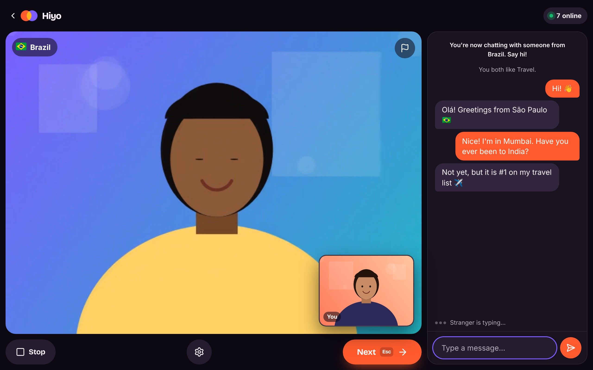
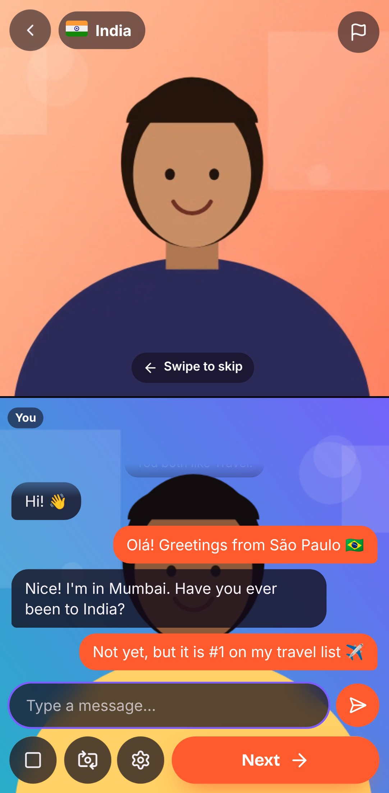
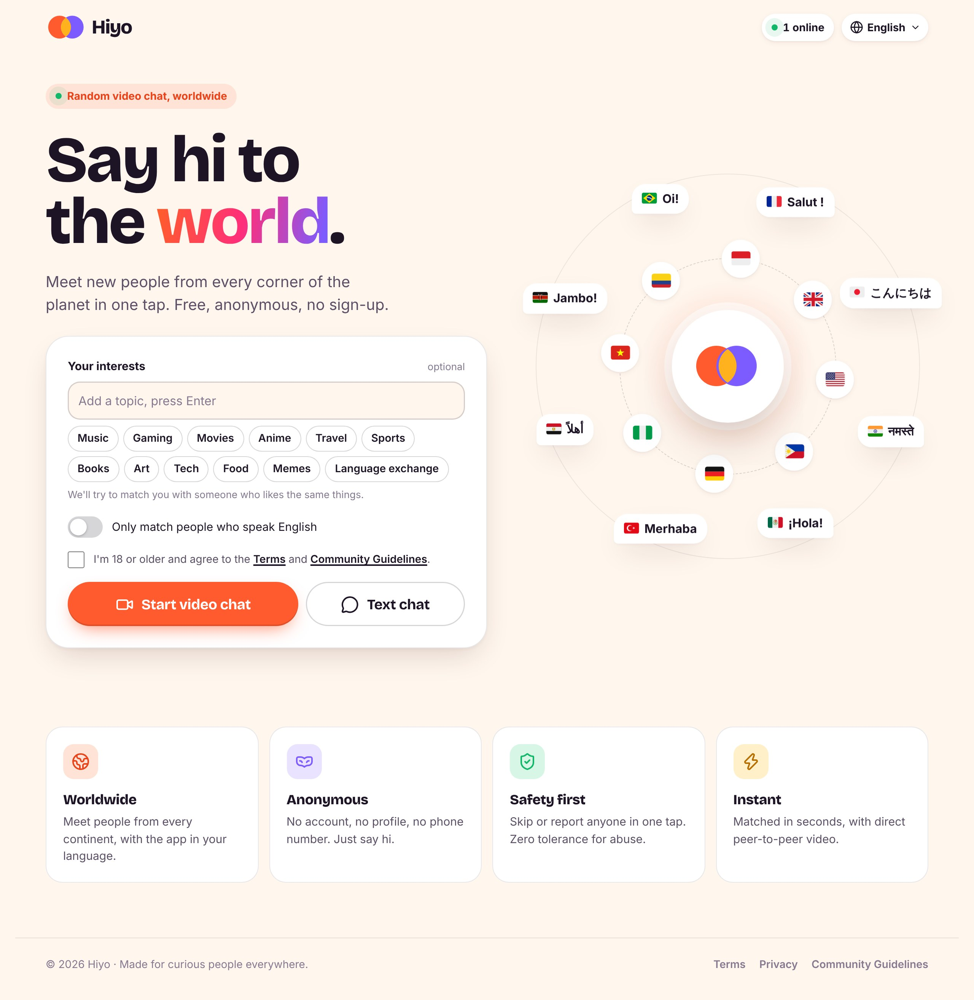
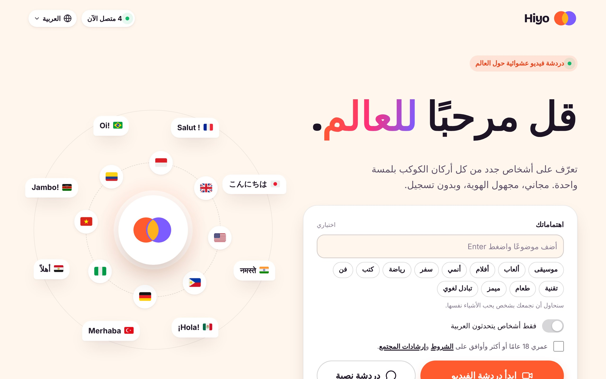
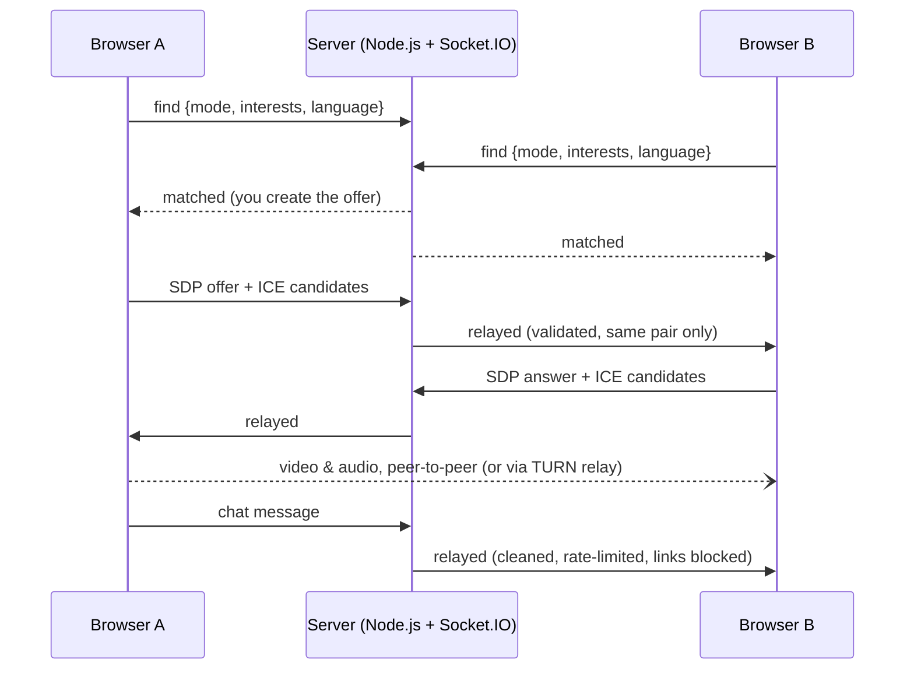

# Hiyo — say hi to the world 👋

Random 1-on-1 **video and text chat** with strangers from every corner of the planet — in the spirit of Omegle and
Monkey, rebuilt for a worldwide audience with safety, speed and 12 languages from day one.

> **Working name.** "Hiyo" is a placeholder brand — change it with one setting (`APP_NAME`). See
> [docs/DESIGN.md](docs/DESIGN.md) for the name shortlist and the full UI design system.

<p align="center">
  
  
</p>
<p align="center">
  
  
</p>

## Features

**Chat**
- 🎥 Peer-to-peer **video** (WebRTC) and **text-only** mode, side-by-side text chat with typing indicator & quick replies
- ⚡ Instant matching; **interests** first (people who share the most tags), then random after a few seconds — like Omegle
- 🌐 **Cross-language interests**: “Music”, “Música” and “音楽” are the same tag, so people match across languages
- 🗣️ Optional **“only people who speak my language”** filter
- 🏳️ Stranger's **country flag** (renders on Windows too) — from Cloudflare/Vercel/CloudFront geo headers or the device time zone
- 👉 **Swipe to skip** on phones, **Esc** on desktop, auto-find-next, mute / camera off / switch camera, device picker
- 📱 Mobile-first split-screen layout, desktop layout with picture-in-picture, installable PWA

**Worldwide**
- 🌍 **12 languages**, server-rendered (instant, SEO-indexed `/es`, `/hi`, `/ar`… with `hreflang`):
  English, Español, Português, Français, Deutsch, العربية (RTL), हिन्दी, Bahasa Indonesia, Türkçe, Русский, 日本語, 简体中文
- Auto-detects the browser language; remembers manual choice
- Low-bandwidth defaults (640×480, capped bitrate) for mobile networks; WebSocket with HTTP long-polling fallback for restrictive networks
- STUN + **TURN** support (self-hosted coturn, any provider, or Cloudflare's global TURN) so strict NATs and mobile carriers connect

**Safety** (the reason Omegle shut down in 2023 — take it seriously)
- 18+ consent gate, Terms, Privacy Policy and Community Guidelines pages
- **Report** button (also works for the person you *just* skipped); reported people are never re-matched with the reporter
- **Automatic temporary bans** after reports from several different people; bans survive restarts
- Video **blurs while you're reporting**; optional “blur new people until I tap”
- Links blocked in chat (anti-spam/scam), message cleaning, rate limits on everything
- Admin API to review reports (with the last messages of the reported chat) and ban/unban
- No accounts, no ads/trackers, IPs stored only as keyed hashes; optional `FORCE_RELAY` hides IPs from strangers
- Strict security headers (CSP without `unsafe-inline`, no framing, camera/mic limited to the site)

## Quick start

Requires **Node.js 20.11+** (check with `node -v`).

**1. Get the code.** Until it's merged into `main`, the app lives on the `claude/beautiful-volta-k7nkqw` branch:

```bash
git clone -b claude/beautiful-volta-k7nkqw https://github.com/Amartyyaaa/live-cam.git
```

```bash
cd live-cam
```

No Git? On GitHub switch to that branch, click **Code → Download ZIP**, unzip it, and open a terminal *inside*
the unzipped folder.

**2. Install and start — inside the project folder** (the one that contains `package.json`):

```bash
npm install
```

```bash
npm start
```

> **Windows:** running `npm install` anywhere else — e.g. directly in `C:\Users\<you>` — fails with
> `EPERM: operation not permitted`. Keep the project in a plain folder such as `C:\dev\live-cam`
> (OneDrive-synced folders and antivirus "controlled folder access" can also block npm).

Open http://localhost:3000 in two different browsers (or one normal + one private window) and click **Start video chat** in both.
Cameras need a secure context: `localhost` works; anything else needs **HTTPS**.

For development with auto-restart:

```bash
npm run dev
```

## How it works



Video and audio **never pass through the app server** — it only introduces people and relays small messages, so one
modest server can host thousands of simultaneous users. The only heavy traffic is TURN relaying for users who can't
connect directly.

## Configuration

Everything is set with environment variables — see [`.env.example`](.env.example) for the full, commented list.

| Variable | Default | What it does |
|---|---|---|
| `APP_NAME` | `Hiyo` | Brand name on every page, title and the PWA manifest |
| `PUBLIC_URL` | — | Your site URL (canonical / hreflang / social links, allowed origin) |
| `CONTACT_EMAIL` | `support@example.com` | Shown on legal pages — **set it** |
| `SERVER_SECRET` | random per start | Keys the IP hashes; set it so IP bans survive restarts |
| `ADMIN_TOKEN` | — | Enables the admin API |
| `TURN_URLS` + `TURN_SECRET` | — | Your coturn server (time-limited credentials) |
| `CLOUDFLARE_TURN_KEY_ID` + `CLOUDFLARE_TURN_API_TOKEN` | — | Use Cloudflare's TURN instead |
| `CLIENT_IP_HEADER` | — | e.g. `cf-connecting-ip` when the site sits behind Cloudflare |
| `TRUST_PROXY` | private networks | Which proxies may set `X-Forwarded-For` |
| `REPORT_THRESHOLD` / `BAN_HOURS` / `IP_BAN_HOURS` | `3` / `24` / `1` | Auto-ban policy |
| `BLOCK_LINKS` | `true` | Refuse chat messages containing links |
| `FORCE_RELAY` | `false` | Send all media through TURN (hides IPs; costs bandwidth) |
| `DATA_DIR` | `./data` | Where `bans.json` and `reports.jsonl` live |

## Deploying

The app is a single Node.js process with no database. Anything that runs Node and supports WebSockets works:
**Render, Railway, Fly.io, DigitalOcean App Platform, a VPS…**

### Docker

```bash
docker build -t hiyo .
```

```bash
docker run -d -p 3000:3000 -v hiyo-data:/data --env-file .env --name hiyo hiyo
```

### VPS with automatic HTTPS (Caddy)

```caddyfile
hiyo.example {
    reverse_proxy 127.0.0.1:3000
}
```

Caddy gets a Let's Encrypt certificate automatically and forwards WebSockets. The default `TRUST_PROXY` already trusts a
proxy on the same machine.

### Put Cloudflare in front (recommended for a worldwide audience)

Free DDoS protection, a global edge network, and the `CF-IPCountry` header gives exact visitor countries for the flags.
WebSockets are supported out of the box. Set `CLIENT_IP_HEADER=cf-connecting-ip` and allow only
[Cloudflare's IP ranges](https://www.cloudflare.com/ips/) to reach your server, so nobody can fake that header.

### TURN server — don't skip this

Without TURN, roughly 10–20% of people (strict NATs, many mobile carriers, corporate networks) will see “Couldn't
connect”. Options:

1. **Self-hosted [coturn](https://github.com/coturn/coturn)** on a small VPS with good bandwidth:

   ```ini
   # /etc/turnserver.conf
   listening-port=3478
   tls-listening-port=5349
   fingerprint
   use-auth-secret
   static-auth-secret=<same value as TURN_SECRET>
   realm=turn.hiyo.example
   cert=/etc/letsencrypt/live/turn.hiyo.example/fullchain.pem
   pkey=/etc/letsencrypt/live/turn.hiyo.example/privkey.pem
   no-cli
   no-multicast-peers
   denied-peer-ip=10.0.0.0-10.255.255.255
   denied-peer-ip=172.16.0.0-172.31.255.255
   denied-peer-ip=192.168.0.0-192.168.255.255
   ```

   Then set `TURN_URLS=turn:turn.hiyo.example:3478?transport=udp,turn:turn.hiyo.example:3478?transport=tcp,turns:turn.hiyo.example:5349?transport=tcp` and `TURN_SECRET`.
   For global users, run a few TURN servers in different regions.
2. **Cloudflare Realtime TURN** — anycast across Cloudflare's network; set the two `CLOUDFLARE_TURN_*` variables.
3. **Any TURN provider** with static credentials (`TURN_USERNAME` / `TURN_CREDENTIAL`).

## Moderation & admin API

Reports are kept in memory and appended to `DATA_DIR/reports.jsonl`; bans are saved to `DATA_DIR/bans.json`.
Set `ADMIN_TOKEN` to enable:

```bash
curl -H "Authorization: Bearer $ADMIN_TOKEN" https://hiyo.example/api/admin/reports?limit=50
```

```bash
curl -X POST -H "Authorization: Bearer $ADMIN_TOKEN" -H "Content-Type: application/json" \
  -d '{"key":"c:<clientId from a report>","hours":720,"reason":"nudity"}' \
  https://hiyo.example/api/admin/bans
```

```bash
curl -X DELETE -H "Authorization: Bearer $ADMIN_TOKEN" https://hiyo.example/api/admin/bans/c:<clientId>
```

Ban keys are `c:<clientId>` (one browser) or `i:<ipHash>` (a network — use sparingly; many people can share one IP).

## ⚠️ Before you launch publicly

Anonymous video chat with strangers attracts abuse. Omegle shut down in November 2023 after 14 years, its founder citing
the cost of fighting misuse. Plan for it from day one:

- [ ] **HTTPS** everywhere and a **TURN** server
- [ ] Set `SERVER_SECRET`, `ADMIN_TOKEN`, `CONTACT_EMAIL`, `PUBLIC_URL`; mount a persistent `DATA_DIR`
- [ ] **Have a lawyer review** the Terms, Privacy Policy and Guidelines (in `server/views/docs/`) for every market you
      target, and translate them. Laws that may apply include the EU Digital Services Act and GDPR, the UK Online Safety Act,
      US federal law requiring providers to report child sexual abuse material to NCMEC, Australia's Online Safety Act,
      India's IT Rules and DPDP Act, and Brazil's LGPD
- [ ] Decide on **age assurance**: a checkbox is the bare minimum, and regulators increasingly expect more
- [ ] Add **automated content moderation** for video and text (e.g. periodic frame sampling to a nudity/CSAM
      classifier, hash-matching services) plus a **human review** workflow for reports and appeals
- [ ] Watch `/healthz`, back up `DATA_DIR`, and review `reports.jsonl` daily

## Scaling

- **One instance** comfortably handles thousands of concurrent users (signalling is tiny; media is peer-to-peer).
- **Several instances**: the matchmaking queue lives in memory. Move it to Redis (the `Matchmaker` class is pure
  and isolated for exactly this) and add the Socket.IO Redis adapter, with sticky sessions for the polling fallback.
- **Bandwidth** goes almost entirely to TURN: budget roughly 0.5–1 Mbps per relayed participant.

## Languages

Each language is one JSON file in [`locales/`](locales). To add one:

1. Copy `locales/en.json` to `locales/<code>.json` (e.g. `vi.json`) and translate the values. Keep `{placeholders}` and
   the `*star*` around the highlighted word in `hero.title`. Missing keys fall back to English.
2. For right-to-left scripts, add the code to `RTL` in `server/render.js` (Arabic, Persian, Hebrew and Urdu are already listed).
3. Restart — the page appears at `/<code>`, in the language menu, the sitemap and `hreflang` tags.

## Renaming the brand

Set `APP_NAME`. The logo is two overlapping circles (you + a stranger) drawn in code: its colours are the `--brand`,
`--violet` and `--sun` tokens in `public/css/app.css`; update `public/favicon.svg` and run `npm run gen:images` to rebuild
the PNG icons and the social-preview image.

## Testing

```bash
npm test
```

51 unit and integration tests (matchmaking, moderation, sanitising, TURN credentials, geo, real Socket.IO clients
against the real server, HTTP security headers, admin API).

```bash
npm run test:e2e
```

End-to-end: real Chromium browsers with fake cameras connect through the real server — matching, peer-to-peer video,
chat, link blocking, skipping, reporting & bans, text mode, RTL and the back button. Needs Playwright
(`npm i -D playwright && npx playwright install chromium`).
`npm run screenshots` regenerates `docs/screenshots/`.

## Project structure

```
server/
  index.js          entry point (config, start, graceful shutdown)
  app.js            wires HTTP + Socket.IO + chat
  chat-server.js    sessions, pairing, signalling & message relay, reports
  matchmaker.js     the matching queue (pure, unit-tested)
  moderation.js     reports, strikes, bans, persistence
  web.js            pages, security headers, admin API
  render.js         server-side i18n templating
  ice.js geo.js sanitize.js rate-limit.js config.js
  views/            HTML templates (+ legal docs)
public/
  js/               browser modules: main, chat, peer (WebRTC), media, home, i18n…
  css/app.css       the design system
  fonts/ icons/     self-hosted fonts, Lucide icon sprite, app icons
locales/            one JSON file per language
scripts/            e2e test, screenshots, asset generators
test/               node:test suites
docs/               design system, screenshots
```

## Credits

[Socket.IO](https://socket.io) & [Express](https://expressjs.com) (MIT) ·
[Lucide](https://lucide.dev) icons (ISC) ·
[Bricolage Grotesque](https://github.com/ateliertriay/bricolage) (OFL) ·
flag font from [country-flag-emoji-polyfill](https://github.com/talkjs/country-flag-emoji-polyfill) with
[Twemoji](https://github.com/twitter/twemoji) artwork (CC-BY 4.0). See [`public/fonts/LICENSES.md`](public/fonts/LICENSES.md).
