# Hiyo — name & UI design

## 1. Name

Requirements for a worldwide random-chat brand: short (2 syllables), easy to say in any language, no awkward meaning
in major languages, friendly rather than “sketchy”, and room for a strong visual identity.

| Name | Meaning / why it works | Notes |
|---|---|---|
| **Hiyo** ⭐ (working name) | “Hi” + “yo” — two greetings understood almost everywhere. Playful like Monkey, friendly for all ages of adults | In Japanese ひよ evokes a chick (cute); no negative meanings found |
| Kismet | “Fate” in English, Turkish (*kısmet*), Hindi/Urdu (*kismat*), with Arabic/Persian roots — every chat is a lucky meeting | Common word: harder trademark & .com |
| Pangea | The supercontinent when all land was one — “the whole world in one room” | Used by several companies |
| Wavo | A wave is the universal hello gesture | Short, coinable |
| Mundo | “World” in Spanish & Portuguese — strong for Latin America & Brazil | Generic, many uses |
| Saluto | “Greeting” in Italian; close to *salut*, *saludo*, *salute* | Elegant, a bit formal |
| Glimpse | A glimpse into someone else's world | “gl-” is harder for some speakers |
| Strangr | Says exactly what it does; good for search | “Stranger danger” association |

**Before committing:** search trademark databases (e.g. WIPO Global Brand Database, USPTO, EUIPO) and app stores, and
check domains. Short `.com`s are usually taken — consider `.chat`, `.live`, `.app` or a prefix like `sayhiyo.com`.
The name is one setting (`APP_NAME`), so switching later costs nothing.

## 2. Brand

**Personality:** warm, curious, global, safe. The site is dark like a night out — inky plum-black, never grey —
lit up by the warm brand colours, a lemon-yellow cards band and friendly illustrations, so it feels like a party
rather than the sketchy look of many random-chat sites.

**Logo:** two overlapping circles — *you* (orange) and *a stranger* (violet) — and the golden spark where they meet.
It is drawn in code (inline SVG), so it recolours for dark mode and animates: in the searching radar the stranger
circle drifts in and out while we look for someone.

### Colour

| Token | Hex | Use |
|---|---|---|
| `--brand` | `#FF5B2E` | “You”, primary actions (Start, Next, Send), your chat bubbles |
| `--violet` | `#7C5CFF` | “The stranger”, focus rings, interest tags |
| `--sun` | `#FFB21E` | The spark — logo centre, highlights |
| `--pink` | `#FF2E7A` | Gradient bridge in the headline |
| `--mint` | `#12B76A` | Live/online, safety |
| `--danger` | `#E11D48` | Report, mute-off states |
| `--lemon` | `#FFE14D` | The cards band and the “Start a random chat now” card |
| `--bg` / `--ink` | `#0B0811` / `#F8F3FB` | Inky page, soft white text (the whole site is dark) |
| `--room-bg` | `#0D0913` | The chat room — dark so faces stand out |

Primary buttons use 19px bold labels so white-on-orange meets WCAG large-text contrast.

### Type

- **Display:** Bricolage Grotesque (variable, self-hosted, ~40 KB) — characterful headlines and buttons, tight tracking.
- **Body:** each device's system UI font, which covers every script (Arabic, Devanagari, CJK, Cyrillic…).
- Letter-spacing is reset to 0 and line-height increased for Arabic, Hindi, Japanese, Chinese and Russian.

### Icons & flags

- [Lucide](https://lucide.dev) line icons in one SVG sprite (28 icons, 5 KB).
- Country flags use emoji plus a 78 KB flag font that loads only when a flag is shown — so flags work on **Windows**,
  which has no flag emoji.

### Motion

**The intro:** hellos in 30+ languages (Hola, こんにちは, Привет, नमस्ते, مرحبا…) drift across the dark page, then fly
together and pack into the letters of the brand name, which becomes a multilingual word cloud; the headline and buttons
rise in underneath. It is drawn on a `<canvas>`, spells whatever `APP_NAME` is, re-lays itself out on resize and is
skipped entirely with `prefers-reduced-motion`.

Elsewhere: the tilted cards band and flag rows scroll slowly; radar pulses with flags “blipping” while searching; chips
and bubbles pop in. Everything respects `prefers-reduced-motion`.

## 3. Screens

### Landing — “Say hi to the world.”

The intro word cloud, then a page with real content: a lemon band of tilted, illustrated people cards saying hello in
their language (and a brand card), a desktop + phone showcase, **three steps** (sign in → agree to the rules →
press start), the **safety lab**, interests and flags from around the world, a big “Start a random chat now” card and
an FAQ.

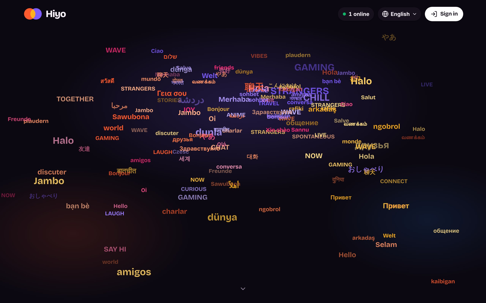
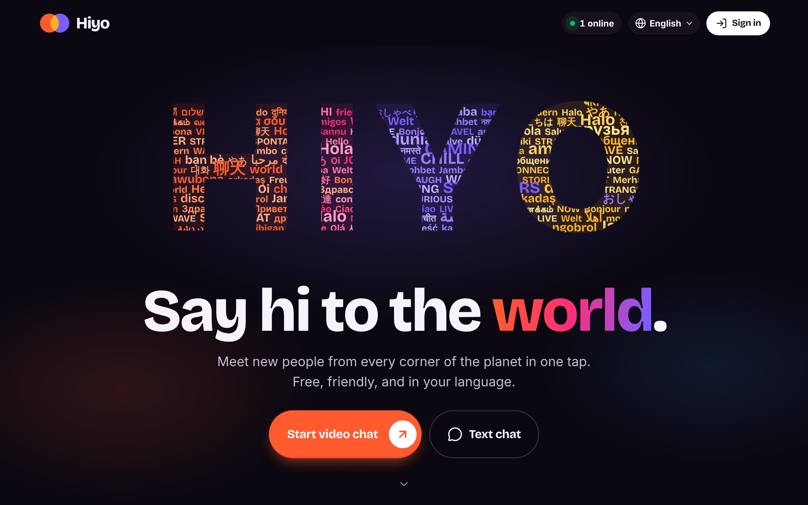

| Phone | Arabic (right-to-left) | Hindi |
|---|---|---|
| 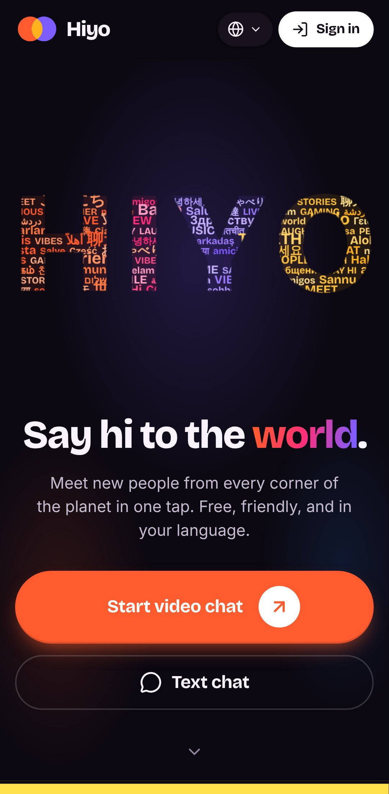 | 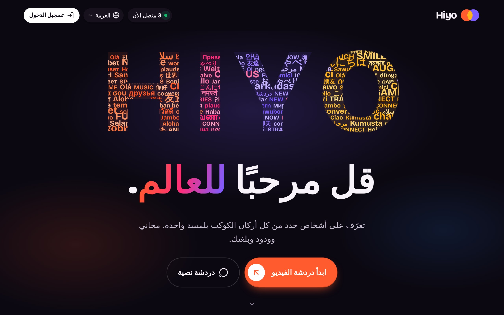 | 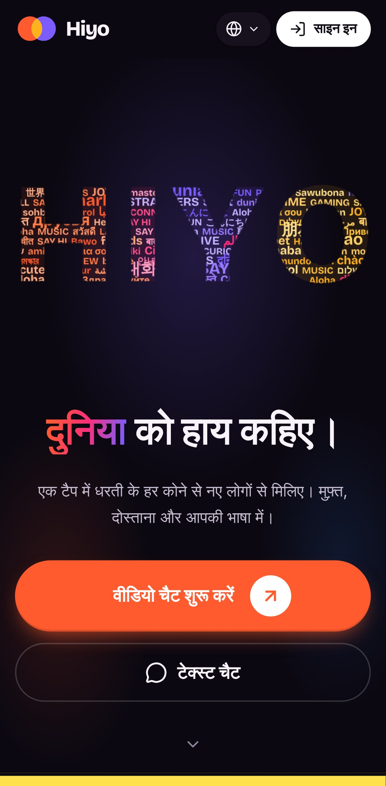 |

The whole page: [home-full.jpg](screenshots/home-full.jpg).

### Sign in → guidelines → lobby

**Start** never matches anyone straight away. Signed-out visitors get the sign-in screen (Continue with Google; email
and password under “More sign-in options”), then the community guidelines sheet — two checkboxes, **Agree all &
continue** or **I disagree** — and finally the lobby: your camera preview next to a panel with the Video/Text switch,
interests, the language filter and **Start**. Matching begins only when that button is pressed; returning users go
straight to the lobby.

| Sign in | Guidelines |
|---|---|
| 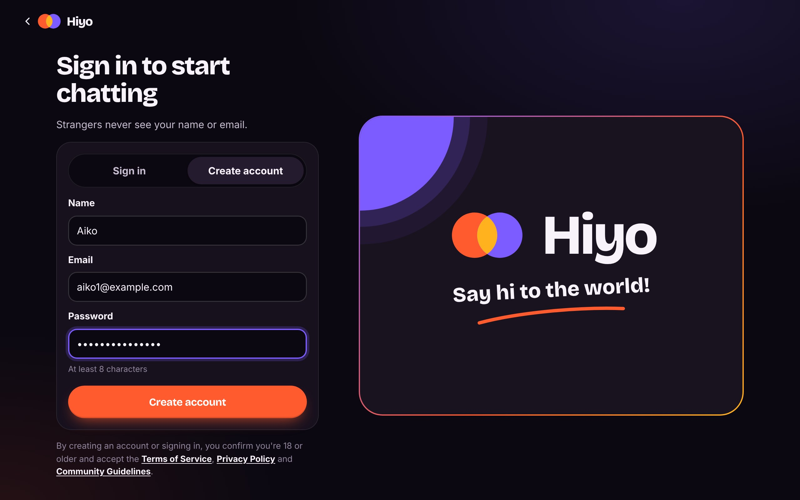 | 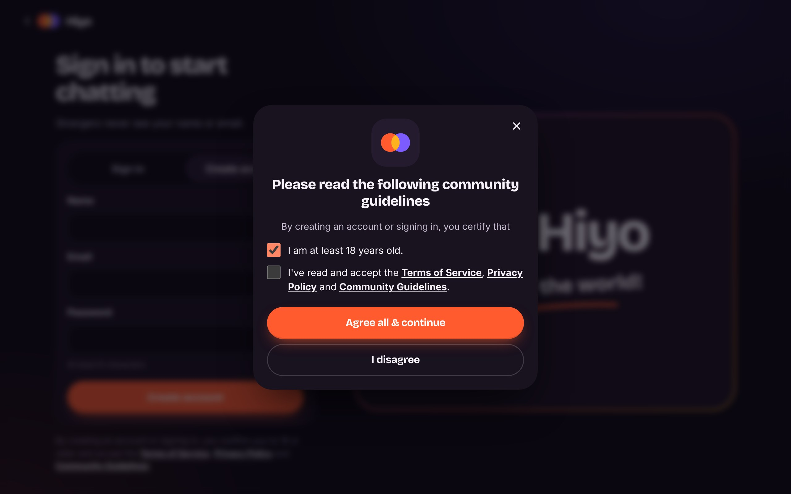 |

| Lobby | Lobby (phone) |
|---|---|
| 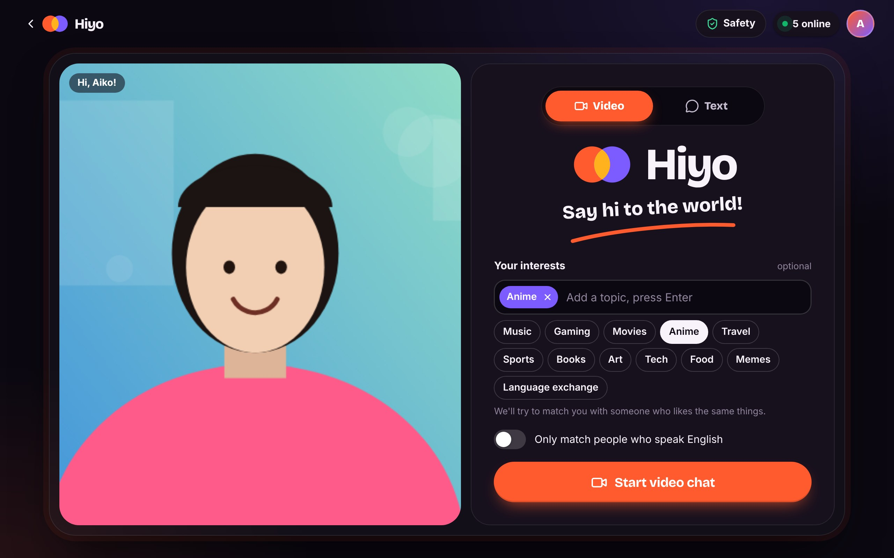 | 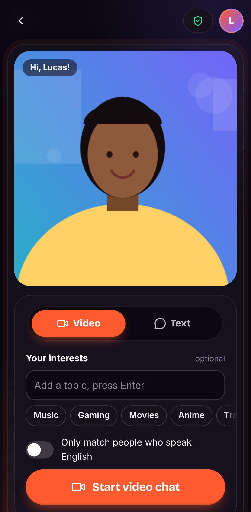 |

On phones the preview shrinks so Start stays on screen, and the interest suggestions become one swipeable row.
Text mode never turns the camera on.

### Chat room — desktop

Big stranger video with country chip and report flag, your camera picture-in-picture, the conversation on the right,
and a control bar: **Stop · switch camera · settings · Next (Esc)**. Like Monkey there are no mute or
camera-off buttons: the browser asks for camera and microphone once, and they stay on for the whole video chat.

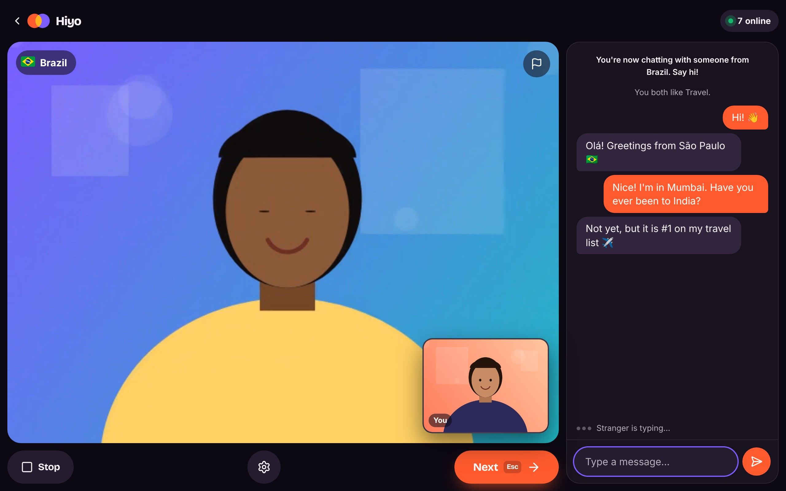

### Chat room — phone (Monkey-style split screen)

Stranger on top, you below, the conversation floating over your own video so the stranger is never covered.
**Swipe the stranger away** to skip; the back gesture returns to the lobby, and once more to the landing page, which
switches the camera off.

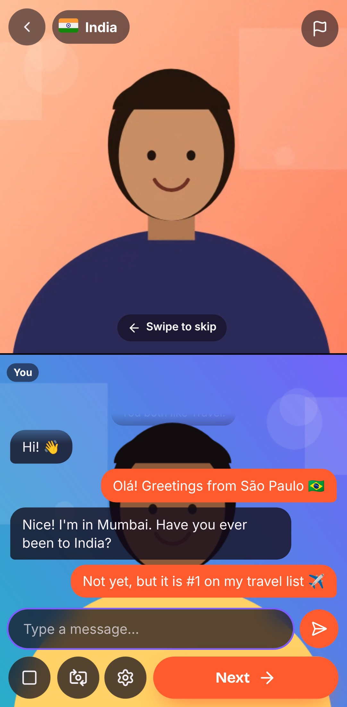

### Searching

A radar pulses from the logo while flags from around the world blip in. The chat panel reassures: “Safety first”.
After 15 seconds a tip suggests removing filters.

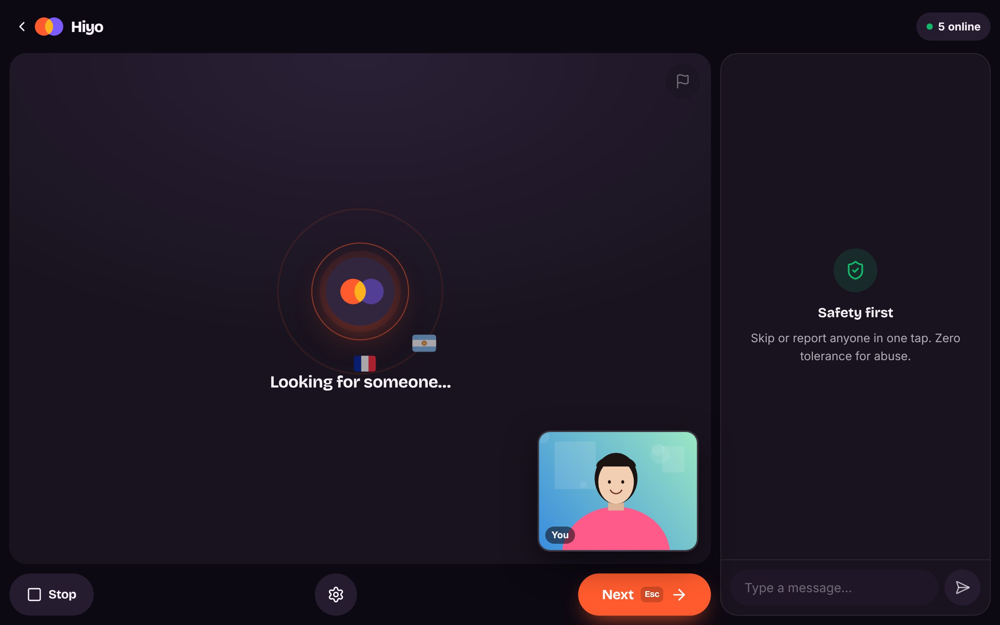

### Safety

The report sheet blurs the stranger's video while you pick a reason; reporting ends the chat instantly and you're
never matched again. Settings offer “blur new people's video until I tap”.

| Report | Settings (phone) |
|---|---|
| 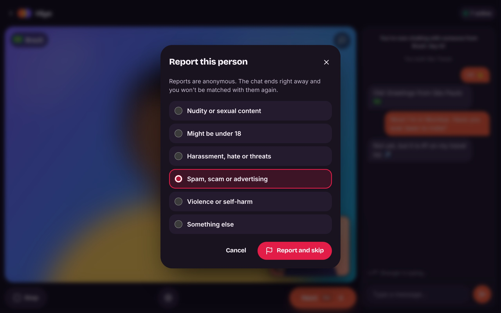 | 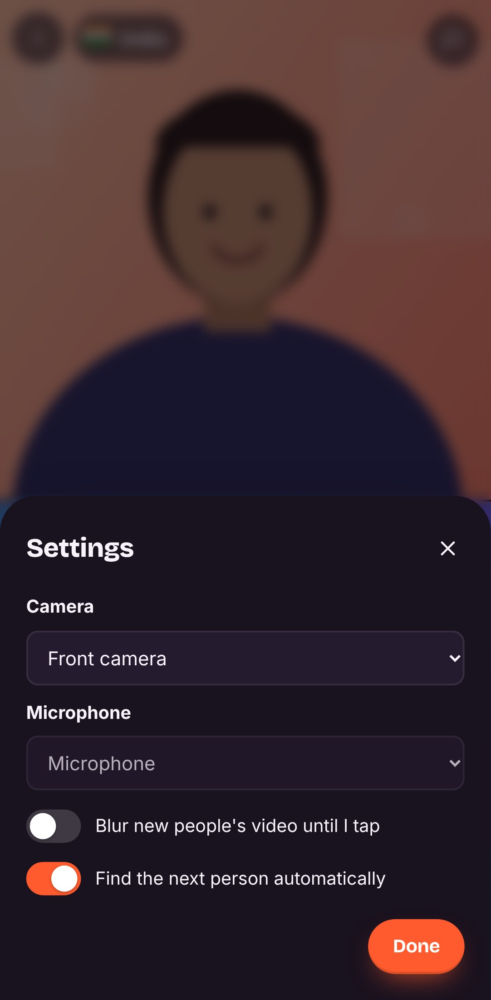 |

### Text-only mode (Spanish)

No camera needed — the conversation becomes the stage, with the stranger's country in the header.

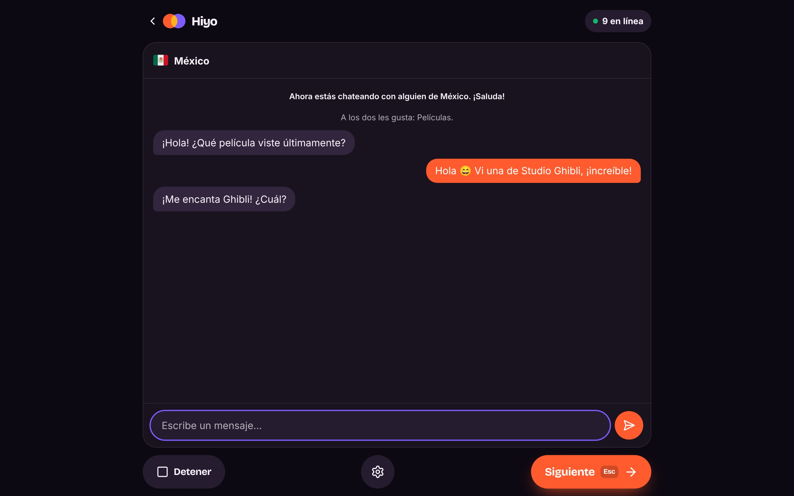

## 4. UX principles

1. **A deliberate start.** One account and one guidelines check, once — then the lobby lets you see yourself and pick
   video or text before anyone sees you. Nobody is matched until they press Start.
2. **Safety is visible, not buried.** Report is always one tap away (and works for the person you just skipped),
   reporting blurs the video, and safety reassurance fills empty states.
3. **Global by default.** Server-rendered translations, right-to-left layouts, interests that match across languages,
   flags that work everywhere, low-bandwidth video defaults, and a long-polling fallback for restrictive networks.
4. **Respect the device.** Mobile-first split screen and swipe gestures, keyboard shortcuts on desktop, the back button
   closes the chat, the camera turns off when you leave.
5. **Accessible.** Keyboard-reachable controls, visible focus, screen-reader labels and live regions for messages,
   toggle buttons with `aria-pressed`, reduced-motion support.
